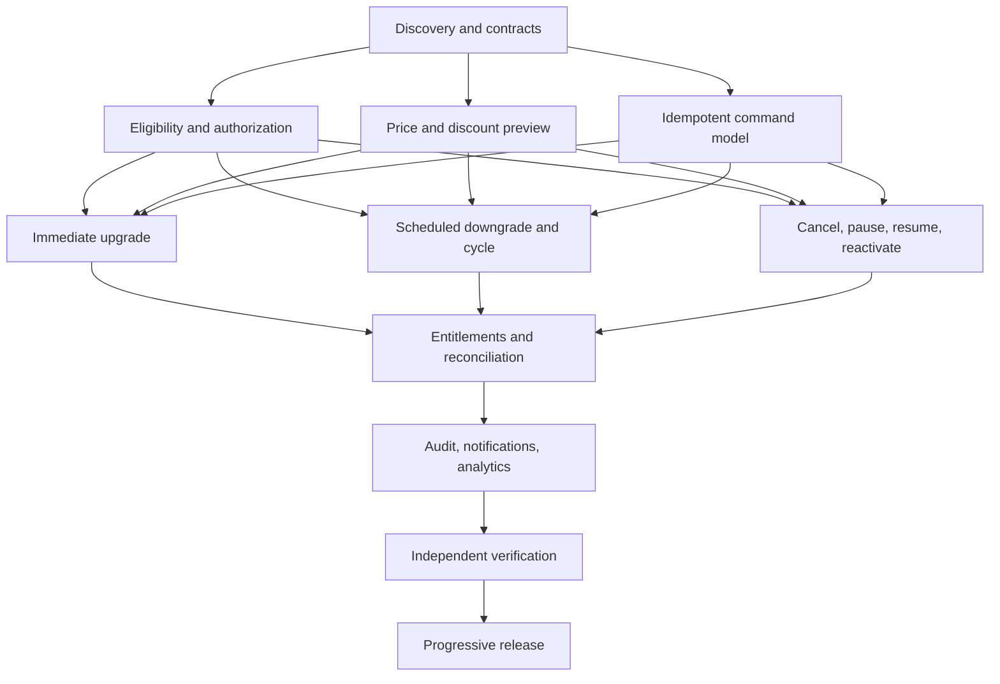

# Dependency Graph

Eligibility, preview and idempotency can proceed in parallel after discovery if contracts are stable. Shared files require explicit ownership or isolated workspaces. Verification inspects implementation evidence independently.